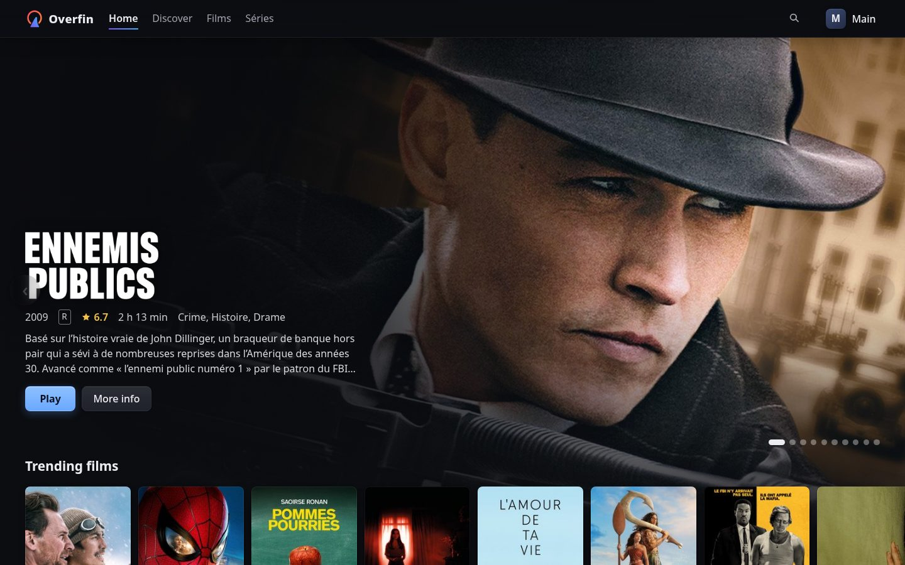
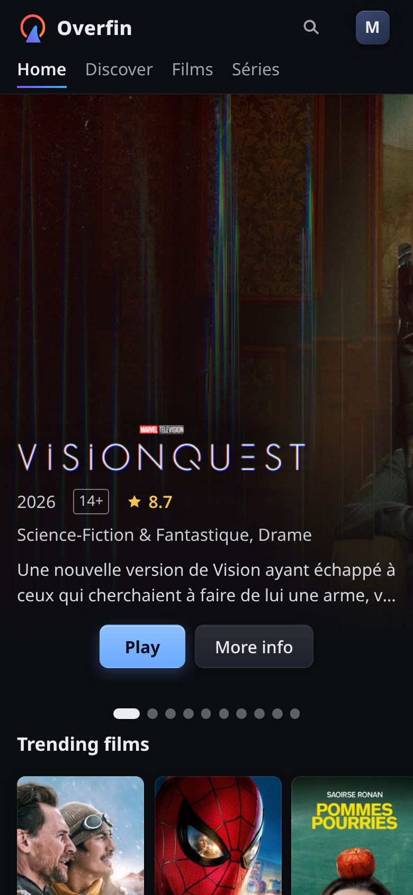
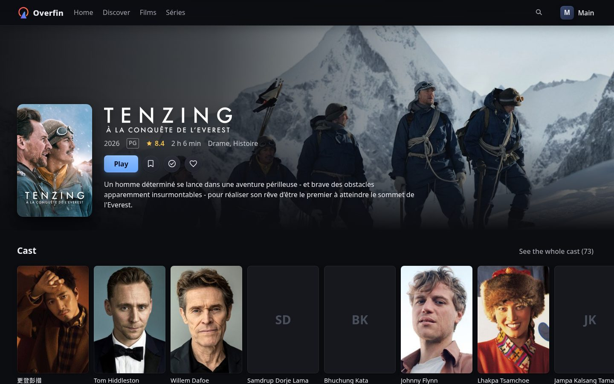
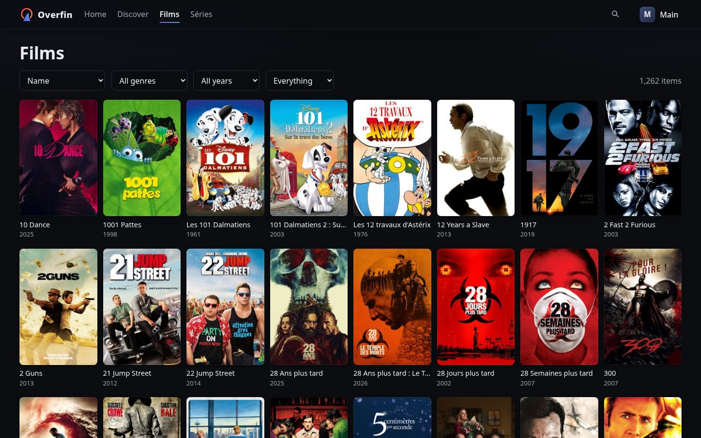

# Overfin

**Your own streaming service, on top of Jellyfin.**

Overfin puts a proper front door on your Jellyfin server: its own sign-in,
profiles, kids limits that hold, invitations, requests and a clean web app.
Share your library with family and friends without putting Jellyfin itself
on the internet, and without giving anyone a Jellyfin account.

It's one container. Start it, open it in a browser, and its setup page asks
for the rest.

```sh
docker run -d --name overfin -p 8080:8080 \
  -v overfin-data:/data -v overfin-secrets:/secrets \
  ghcr.io/overfin/overfin:0.3.0
```

Then open `http://<the machine>:8080`. Getting it on the internet with
HTTPS, behind your own proxy, or with your own identity provider: see
[Running it](#running-it).

<p>
  
  
</p>
<p>
  
  
</p>

## What you get

**For the people watching**

- **Signing in with their email**: a code sent there, or a password. No
  Jellyfin account, no app to install.
- **Profiles**, each with its own history and an optional PIN. **Kids
  profiles** see only titles rated within their limits, on real age
  ratings from TMDB for the country you choose: everything else is hidden
  everywhere, not just greyed out, and can't be played.
- **A catalog that looks the part**: posters, logos and backdrops from
  TMDB, cast pages, users' scores, search, trending and upcoming titles. A
  title your libraries don't have can be requested (with Seerr).
- **Watching in the browser**: played as is whenever the browser can,
  subtitles, audio tracks, quality choice, seek previews, skipping intros
  (when Jellyfin has their markers), the next episode lined up, and
  picking up where they left off on any device.
- **Continue watching, a watchlist, favorites and watched marks** per
  profile; and the right to download what's kept about them, or delete it.

**For you, running it**

- **One container**: HTTPS by itself (Let's Encrypt) when you give it a
  domain, behind your own reverse proxy, or plain http on a LAN.
- **A control panel**: people and their accounts, invitations, templates
  (how many streams and profiles an account gets), limits, email, Jellyfin
  and Seerr connections, fixing titles Jellyfin matched wrong.
- **Bringing people over** from Jellyfin, their watch history included,
  with their old username and password, once.
- **Your own identity provider** instead of Overfin's sign-in, if you have
  one: OpenID Connect (Authentik, Pocket ID…) or a proxy's forward auth.
- **An API** for your own apps, and a key-protected one for tools such as
  Stewarr.

```
browser ──▶ the site (overfin-web, or your own)
   └──▶ /api/v1/*  ──▶  Overfin  ──▶  Jellyfin (private)
                          │
                          └──▶  its own sign-in, or your identity provider
```

Every app, official or not, talks to Overfin through the same public,
documented API, so a site or an app of your own can do everything the
official ones do, with total freedom on looks and feel. This repository is
the server; [overfin-web](https://github.com/overfin/web) is its web app.

## Where it stands

Overfin is young: it started in October 2026, its releases are early
pre-releases (0.x), and it's developed by one person with AI assistance.

- **It runs one real server**, every day, against Jellyfin 12, with its
  own sign-in. That is the extent of its real-world use so far.
- **Browser only.** There are no TV or phone apps yet, and Jellyfin's own
  apps don't go through Overfin: people who move to it watch in a browser
  (phones included).
- **Jellyfin 12 only.**
- **HTTPS by itself is new**: tested, but not yet run on a real domain.
  Behind a reverse proxy is the well-trodden path.
- **Releases are pre-releases.** Each comes as a signed image for x86 and
  ARM (`ghcr.io/overfin/overfin`). The API, the settings and the database
  can still change between versions; the database migrates itself.
- **Its security rules are written down and tested, but nobody outside the
  project has reviewed them yet.**

Try it, read it, build on it; don't make something you depend on rely on it
yet.

## What's missing

The main gaps (details in [ROADMAP.md](ROADMAP.md)):

- TV and phone apps, and a sign-in for native apps.
- A live view of who's watching.
- Email notices (sign-in codes are there).
- SDKs other than JavaScript.
- Jellyfin 10.11 support.

The API specification also describes endpoints that aren't served yet; they
are marked `x-status: planned`.

## Running it

You need a **Jellyfin 12** server, ideally not reachable from the internet
(see [SECURITY.md](SECURITY.md), Deployment), with an API key made in its
dashboard, and **Docker** (or Go 1.26). Overfin uses the key only to manage
its own Jellyfin account, never to browse or play.

**1. Run it** with the command at the top: no configuration file is needed.
(The version from the [releases](https://github.com/overfin/server/releases);
`docker build -t overfin .` builds it from source instead.)

**2. Set it up in your browser.** Open `http://<the machine>:8080`: the
setup page asks for the one-time code in Overfin's log
(`docker logs overfin`), Jellyfin's address and API key, and your email and
a password, for you, its first admin. Then sign in.

That's all. People sign in with their email: with a code Overfin sends
there, or a password they set. Without an email server, they sign in with
a password, or with a one-time sign-in link you make for them. The control
panel is at `/admin/`, for admins: add people there, connect an email
server (Settings, Email), switch invitations on.

Overfin keeps its secret key in `overfin-secrets` and everything else in
`overfin-data`: back both up, apart.

### On the internet, with HTTPS

**Overfin can get its own certificate** from Let's Encrypt. Point your
domain at the machine, open ports 80 and 443, and run it with your domain:

```sh
docker run -d --name overfin -p 80:8080 -p 443:8443 \
  -e OVERFIN_DOMAIN=media.example.org \
  -v overfin-data:/data -v overfin-secrets:/secrets \
  ghcr.io/overfin/overfin:0.3.0
```

It renews the certificate by itself, and sends plain-http visitors to
HTTPS. The setup code keeps a fresh install yours, but do the setup right
away.

**Or behind your own reverse proxy**, which handles HTTPS and passes
everything to Overfin on port 8080. Tell Overfin the site's address and the
proxy's, in `/etc/overfin/overfin.toml`
([overfin.example.toml](overfin.example.toml) has every setting):

```toml
[site]
url = "https://media.example.org"

[identity]
trusted_proxies = ["198.51.100.7"]   # your reverse proxy: the client address comes from it
```

Caddy:

```caddyfile
media.example.org {
	reverse_proxy overfin:8080
}
```

nginx (inside your `server { listen 443 ssl; ... }` block):

```nginx
location / {
    proxy_pass http://overfin:8080;
    proxy_set_header Host $host;
    proxy_set_header X-Forwarded-For $remote_addr;
    proxy_set_header X-Forwarded-Proto $scheme;
    proxy_buffering off;              # video streams
    proxy_read_timeout 1h;
}
```

Traefik (labels on Overfin's container):

```yaml
labels:
  - traefik.http.routers.overfin.rule=Host(`media.example.org`)
  - traefik.http.routers.overfin.tls.certresolver=letsencrypt
  - traefik.http.services.overfin.loadbalancer.server.port=8080
```

**Your own client instead?** Set `[site] serve` to its folder: Overfin
serves it the same way, with the Content-Security-Policy you give it
(`csp`), and `spa_fallback = true` for single-page apps. With
`serve = "none"`, Overfin only answers `/api/`, and your proxy serves the
site, asking Overfin's gate first (`forward_auth` to `/api/v1/gate`) to keep
its pages private.

### Signing in through your identity provider

Instead of Overfin's own sign-in, people can sign in through an OpenID
Connect provider (`identity.mode = "oidc"`), or a reverse proxy's forward
auth (`"forwardauth"`). [deploy/](deploy) runs Overfin with Caddy and
Pocket ID (passkey logins) in one compose file, set up by a script.

By hand: make a confidential OpenID client at your provider with the
redirect URL `https://media.example.org/api/v1/auth/callback`, allowed to
issue refresh tokens (usually the `offline_access` scope), then:

```toml
[identity]
mode = "oidc"
trusted_proxies = ["198.51.100.7"]   # your reverse proxy

[oidc]
issuer = "https://auth.example.org/application/o/site/"
client_id = "overfin"
redirect_url = "https://media.example.org/api/v1/auth/callback"
```

with the client secret in `OVERFIN_OIDC_CLIENT_SECRET`. Anyone who can log
in at your provider gets an account, unless you set
`identity.required_group`, or switch invitations on and make them required.

**Leaving your identity provider for Overfin's own sign-in?** While it's
still configured (with its `[connector]`), run `overfin -import-people`
once: everyone it has, with an email, can then sign in with that email,
keeping their account, and the panel's admins stay admins. Then switch to
`identity.mode = "managed"`. People without a password sign in with a code
by email, or a link from the panel.

**Locked out?** `overfin -signin-link you@example.org` prints a one-time
sign-in link, valid a day (with Docker: `docker exec overfin /overfin
-signin-link you@example.org`).

### The control panel

With Overfin's own sign-in, it's at `/admin/` on the site, for admins, who
confirm it's them before going in. `[admin] private = true` keeps it to
private addresses (LAN, VPN); `[admin] listen = ":8081"` takes it off the
site entirely, onto a listener of its own for private addresses only
(publish that port on your LAN address only), where admins sign in at
`http://<that address>:8081/admin/`.

With an identity provider, it has a listener of its own instead, never on
the internet: publish its port on the server's `127.0.0.1` only, and reach
it through an SSH tunnel (`ssh -L 8081:localhost:8081 server`, then
`http://localhost:8081`), or on your LAN or VPN over HTTPS:

```toml
[admin]
listen = ":8081"
group = "overfin-admins"   # who may sign in, at your identity provider
redirect_url = "http://localhost:8081/admin/auth/callback"
```

For real names, add a `[connector]`. With Pocket ID (`kind = "pocketid"`,
`url = "https://auth.example.org"`), set `OVERFIN_CONNECTOR_TOKEN` to its
`STATIC_API_KEY`: Overfin then also sets up its own login client and the
admin group there, and invitation links lead to a one-person sign-up link
(Pocket ID needs `ALLOW_USER_SIGNUPS=withToken`). With Authentik
(`kind = "authentik"`), set it to an Authentik token of intent **API Token**
(not an app password), for a user allowed only to **view users**.

### Moving people over from Jellyfin

Switch migration on in the control panel, let everyone sign in (with
Overfin's own sign-in, add them in the panel or invite them; with an
identity provider, give them a login there), and announce a date. On their first visit, people choose to bring
their previous account and enter its old username and password once. By
default that's a move: the old login and Jellyfin apps stop working for them
at once. Mode "link" keeps the old login working until you press "Move
linked accounts" in its tab. Nobody loses anything by being late.

Overfin never names Jellyfin to the people using your site: speak of their
"previous account", or your old service's name.

## Features

Everything is built in. Accounts and profiles, the library, playback and the
watchlist are always on; the rest is switched on in the control panel.

| Feature | Offers | |
| --- | --- | --- |
| Library | Browsing, images | Always on |
| Playback | Watching, subtitles, limits | Always on |
| Watchlist | Each profile's watchlist | Always on |
| Invitations | Invitations and invite templates | Switch |
| Migration | Bringing Jellyfin accounts over | Switch |
| Catalog | The library's index, matched to TMDB | Always on |
| Discovery | Trending, popular and upcoming titles, from TMDB | Always on; kids profiles see what their ceilings allow |
| Requests | Asking for titles no library has, through Seerr | When Seerr is connected |

Everything people see about a title, its text and its images, comes from
TMDB, in the language set in the panel; Jellyfin's own metadata and images
are never shown (being moved over: ROADMAP.md, milestone 5). TMDB's data
comes from TMDB itself, with the Overfin project's own key, shipped with
Overfin as Jellyfin and Seerr ship theirs: you need no key of your own.
Overfin asks TMDB by itself, by title, never saying who's asking; browsers
never contact TMDB. It keeps TMDB's data as its terms allow (six months at
most), and overfin-web shows TMDB's attribution. The pictures of the
titles your libraries have are kept on disk ahead of time, in `artwork/`
next to the database, so browsing the library never waits for TMDB; the
others are fetched when first shown. The key is TMDB's free,
non-commercial one: a site that charges for access needs TMDB's commercial
terms. Seerr, when connected, is a second source, and takes requests.

Each account asks Seerr through a Seerr user of its own, which Overfin makes
and names after the account (the name the control panel shows), so Seerr's
pages say who asked for what. Seerr's own settings give those users their
permissions, auto-approval and quotas. No one signs in to Seerr as them, and
people never need Seerr itself: keep it private on your network, reachable
by Overfin and you only.

## Other apps

Other apps can read some of what Overfin knows, with a key you make for
each in the control panel's **Apps** tab (shown once, revocable). For now,
how much each film and series is watched, for apps that weigh what to
keep (such as Stewarr): totals per title only, never anything per person.
They ask the control panel's address (the site's, or its own private
listener when you gave it one):

```
GET /apps/v1/watch-stats[?since=2026-10-22T00:00:00Z]
Authorization: Bearer ofapp_…
```

```json
{"titles": [{"kind": "series", "tmdbId": "1399", "tvdbId": "121361", "imdbId": "tt0944947",
  "plays": 12, "viewers": 3, "favorites": 1, "lastPlayed": "2026-10-20", "changedAt": "…"}],
 "generatedAt": "…"}
```

`plays` are plays to the end (a series adds up its episodes), `viewers`
the accounts that watched some of it, `favorites` the profiles that keep
it as a favorite. With `since`, only the titles changed since then.

## Building your own client

- **The API**, specified in [api/openapi.yaml](api/openapi.yaml), with its
  conventions at the top. Errors are typed problem details.
- **The JavaScript SDK**, [sdk/js](sdk/js): one ES module, no dependencies,
  TypeScript types, and a player that handles progress, recovery and
  takeovers.
- **overfin-web**, in
  [its own repository](https://github.com/overfin/web): Overfin's own
  web app, in Svelte and TypeScript on the SDK, bundled by the official
  build and served by default. It's what the real server runs, and it uses
  nothing but the public API, like any client.

## Security

Overfin treats every browser as untrusted and Jellyfin's data as untrusted
input. Among its rules: every route is declared (no passthrough to
Jellyfin), Jellyfin tokens never reach the browser and are encrypted at
rest, Overfin reaches Jellyfin as one locked-down account and decides
itself what each profile may see, images are
re-encoded, nothing is collected for analytics, and between Overfin servers (planned
sharing) nothing is ever trusted by default. What depends on your setup
(HTTPS, where the control panel answers) has a secure default you may
relax for your own server.

The rules are in [SECURITY.md](SECURITY.md), the threats they answer in
[THREAT_MODEL.md](THREAT_MODEL.md). Remember they haven't been reviewed by
anyone outside the project yet.

## Development

```sh
go test ./...
node --test sdk/js/overfin.test.js
go run ./cmd/overfin -config overfin.toml
```

Go with the standard library and three dependencies (a TOML parser, a
pure-Go SQLite, and the Go team's golang.org/x/crypto for getting
certificates from Let's Encrypt). CI runs formatting, vet, staticcheck, govulncheck, the tests
with the race detector, and a check that the API specification matches the
routes.

Useful to know: `overfin -check` tests the configuration and what it points
to (the secret key, Jellyfin, the identity provider) and says in plain words
what's wrong, changing nothing; `SIGHUP` reloads the configuration without dropping
playbacks; `-recover-tokens` gets you going again if the secret key is lost
(PINs and logins are reset, history is kept).

## AI-assisted development

Said plainly: most of Overfin's code and documentation is written by Claude
(Anthropic's AI), and commits it wrote carry a `Co-Authored-By: Claude`
trailer. The maintainer decides what gets built and how it should behave,
and runs every change on a real server with a real library. Each change
passes the tests, vet, staticcheck and govulncheck before it's pushed.

That isn't the same as an independent security review, and Overfin hasn't
had one yet. The security-sensitive parts (sign-in, sessions, who may play
what) are written down in [SECURITY.md](SECURITY.md) and
[THREAT_MODEL.md](THREAT_MODEL.md) so they can be checked; reviews and
reports are very welcome.

## License

[MIT](LICENSE). overfin-web, which the official build bundles, includes
[hls.js](https://github.com/video-dev/hls.js), unmodified, under the Apache
License 2.0.

Overfin is an independent project, not affiliated with or endorsed by the
Jellyfin project, Seerr or TMDB.
